# Examples

Welcome to the `dynestyx` examples page

## Getting Started

- [Quickstart](tutorials/quickstart.ipynb) - Minimal introduction to building models in `dynestyx` and performing inference
- [A Gentle Introduction to Dynestyx](tutorials/gentle_intro/00_index.ipynb) - Multi-part tutorials: NumPyro and Bayesian workflow → discrete-time dynestyx → filtering and MLL → pseudomarginal inference → SVI → continuous-time (SDE, L63) → HMMs → hierarchical / mixed-effect inference with `plate`. These have tons of examples!
- [Filtering and marginal likelihood without NumPyro](tutorials/gentle_intro/03_filtering_mll_no_numpyro.ipynb) - Use `dsx.condition` to return filter results directly.
- [Differentiable optimization without NumPyro](tutorials/gentle_intro/05_svi_no_numpyro.ipynb) - Optimize filter marginal likelihoods and explicit latent-path log densities with JAX and Optax.

## Featured Examples { #gallery }

-   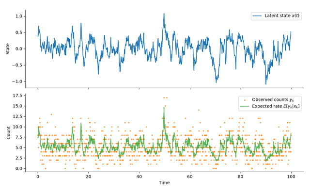

    **[SDEs with non-Gaussian observations](tutorials/sde_non_gaussian_observations.ipynb)**

    Fit a continuous-time latent process to Poisson count observations with variational inference.

    <!-- Thumbnail source: notebook cell 7, output 0 (zero-based indices). Trimmed and padded. -->

-   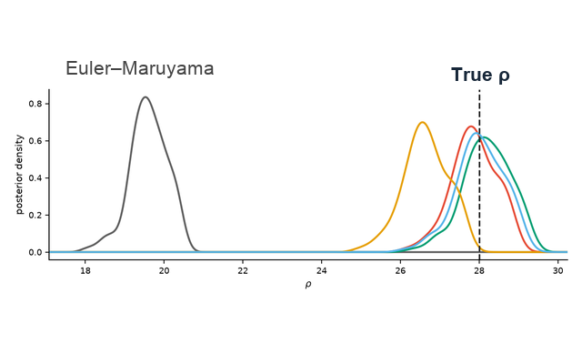

    **[Comparing SDE discretizations on Lorenz–63](deep_dives/sde_discretization_comparison.ipynb)**

    See how the discretization method changes parameter recovery and sampling efficiency.

    <!-- Thumbnail source: cell posterior-figure, output 0. Removed the original legend and labeled the Euler–Maruyama peak and true rho directly. -->

-   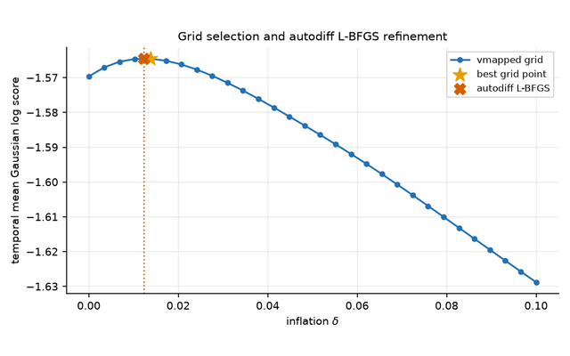

    **[Tuning EnKF covariance inflation with scoring rules](deep_dives/l63_covariance_inflation_scoring.ipynb)**

    Tune ensemble covariance inflation for Lorenz–63 by scoring predictions on held-out observations.

    <!-- Thumbnail source: cell 10e1febf, output 0. Trimmed and padded. -->

-   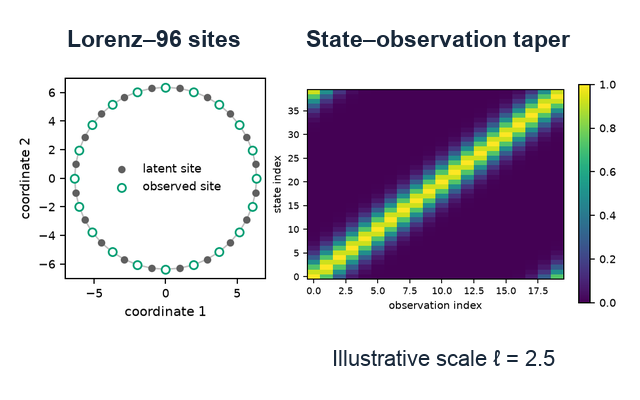

    **[Learning EnKF localization with scoring rules](deep_dives/l96_localization_hyperparameter_scoring.ipynb)**

    Use predictive scores to select how far an observation can influence nearby states on the Lorenz–96 ring.

    <!-- Thumbnail source: cell 075d6d45, output 0. Retained the ring, state–observation taper and shared scale at illustrative length 2.5. -->

-   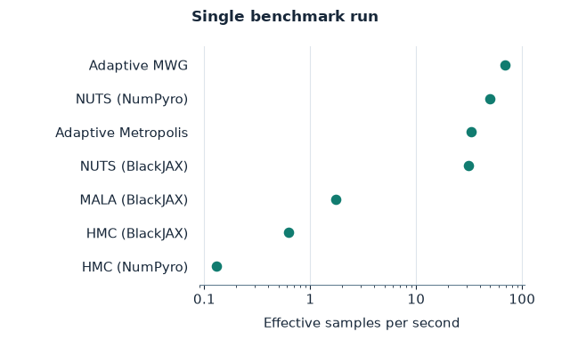

    **[Comparing MCMC algorithms](deep_dives/mcmc_inference_algorithm_comparison.ipynb)**

    Compare posterior estimates and sampling efficiency across NumPyro and BlackJAX samplers.

    <!-- Thumbnail source: cell b1f40fe8, output 11. Replotted all seven saved ESS/s values on a logarithmic axis. -->

-   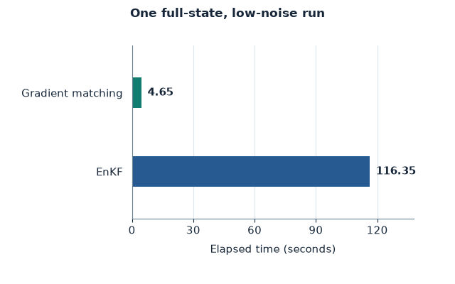

    **[Faster Lorenz–63 inference with full-state observations](deep_dives/l63_speedup_dirac_vs_enkf.ipynb)**

    Compare gradient matching and ensemble Kalman filtering when every state coordinate is observed with little noise.

    <!-- Thumbnail source: cells 8 and 10, output 1 in each (zero-based indices). Replotted the two reported runtimes as bars. -->

-   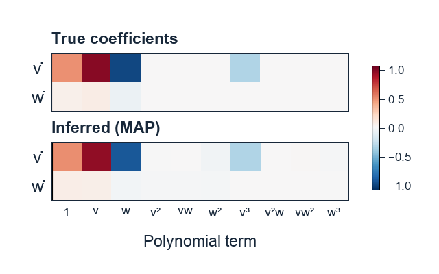

    **[Sparse identification of FitzHugh–Nagumo dynamics](deep_dives/fhn_sparse_id.ipynb)**

    Recover the active polynomial terms of a nonlinear dynamical system from noisy observations.

    <!-- Thumbnail source: notebook cell 25, output 0 (zero-based indices). Retained both heatmaps and their common color scale. -->

-   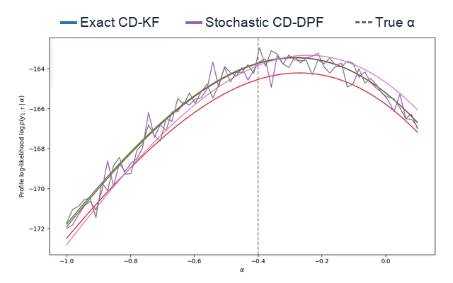

    **[Continuous-time LTI profile likelihood](deep_dives/continuous_time_lti_profile_likelihood.ipynb)**

    Compare approximate filter likelihoods against the exact continuous-discrete Kalman filter.

    <!-- Thumbnail source: cell 7519c00c, output 0. Retained the saved profiles and shortened the legend to the exact CD-KF, stochastic CD-DPF, and true alpha. -->

-   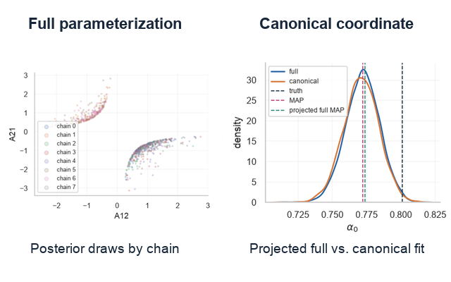

    **[LTI identifiability and canonical parameterization](deep_dives/lti_identifiability_canonicalization.ipynb)**

    See how equivalent state-space models can have different parameters and compare their posteriors in canonical coordinates.

    <!-- Thumbnail sources: cells bbb5a659 and 6075ca12, outputs 2 and 0 respectively. Retained the leftmost panel from each. -->

-   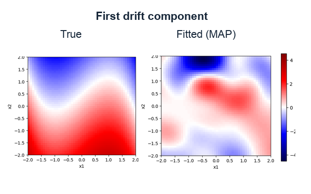

    **[Learning FitzHugh–Nagumo drift with a Gaussian process](deep_dives/gp_drift.ipynb)**

    Use a Gaussian process prior to learn a nonlinear drift field from noisy trajectories.

    <!-- Thumbnail source: notebook cell 20, output 1 (zero-based indices). Retained the first true and MAP drift panels and their shared color scale. -->

## All Examples and Deep Dives

### Examples

-   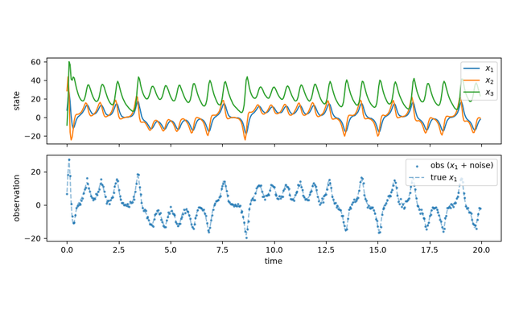

    **[Quick example: Lorenz–63](quick_example.ipynb)**

    <!-- Thumbnail source: cell 03a43c82, output 0. Trimmed and padded. -->

-   

    **[SDEs with non-Gaussian observations](tutorials/sde_non_gaussian_observations.ipynb)**

#### Closed-loop control

-   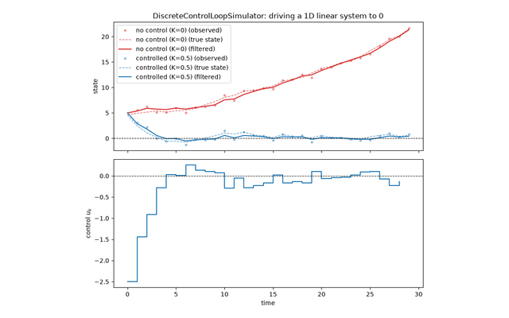

    **[Controller basics](tutorials/control/controller_demo.ipynb)**

    <!-- Thumbnail source: cell 538926f3, output 0. Trimmed and padded. -->

-   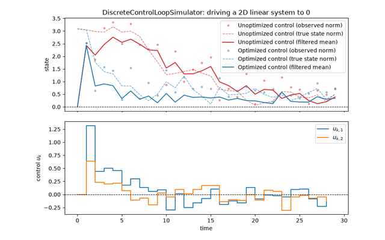

    **[Optimizing a controller](tutorials/control/control_optimization.ipynb)**

    <!-- Thumbnail source: cell 5d6197c9, output 0. Retained the state norm and control input panels. -->

-   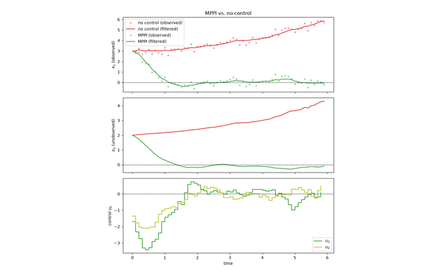

    **[MPPI-inspired model predictive control](tutorials/control/mpc_demo.ipynb)**

    <!-- Thumbnail source: cell 5dbcf7d2, output 0. Trimmed and padded. -->

#### State-space models

-   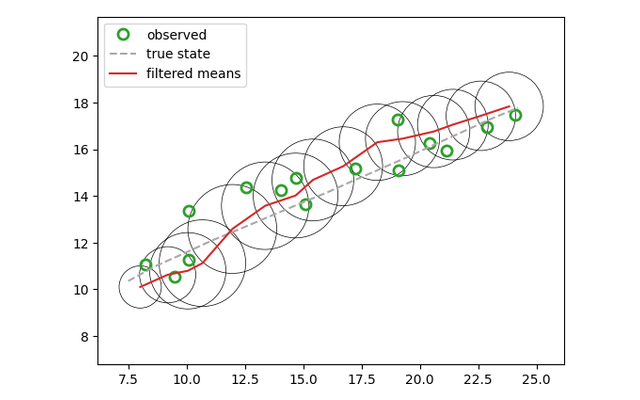

    **[Object tracking with a Kalman filter](tutorials/state_space_models/kf_tracking.ipynb)**

    <!-- Thumbnail source: cell 2cbb6d25, output 0. Trimmed and padded. -->

-   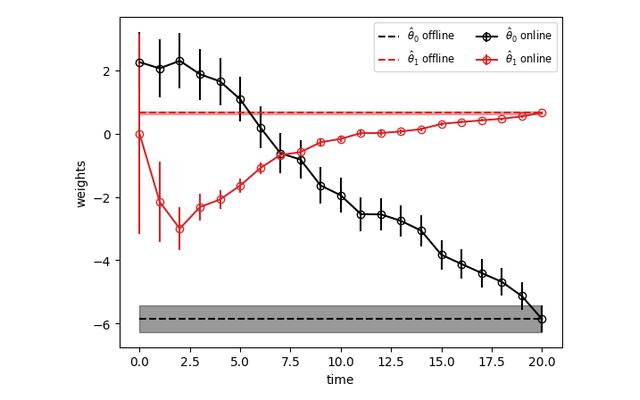

    **[Online linear regression with a Kalman filter](tutorials/state_space_models/kf_linreg.ipynb)**

    <!-- Thumbnail source: cell 1bd0dad6, output 0. Trimmed and padded. -->

-   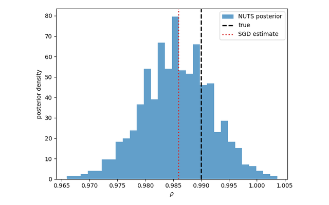

    **[Parameter estimation for linear Gaussian state-space models](tutorials/state_space_models/lgssm_learning.ipynb)**

    <!-- Thumbnail source: cell 43c86dff, output 0. Trimmed and padded. -->

-   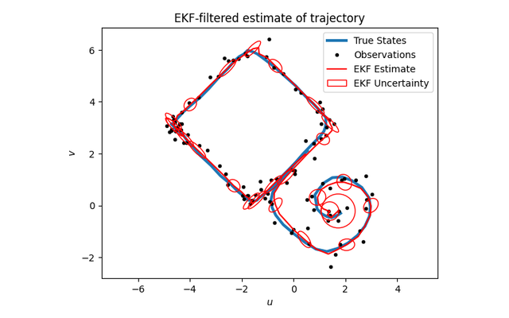

    **[Tracking a spiraling object with an extended Kalman filter](tutorials/state_space_models/ekf_spiral.ipynb)**

    <!-- Thumbnail source: cell fca4aee3, output 0. Trimmed and padded. -->

-   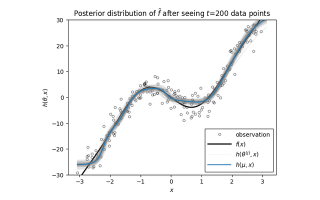

    **[Online learning of a neural network with an extended Kalman filter](tutorials/state_space_models/ekf_mlp.ipynb)**

    <!-- Thumbnail source: cell ee4d1279, output 3. Trimmed and padded. -->

### Deep Dives

#### Filtering and predictive scoring

-   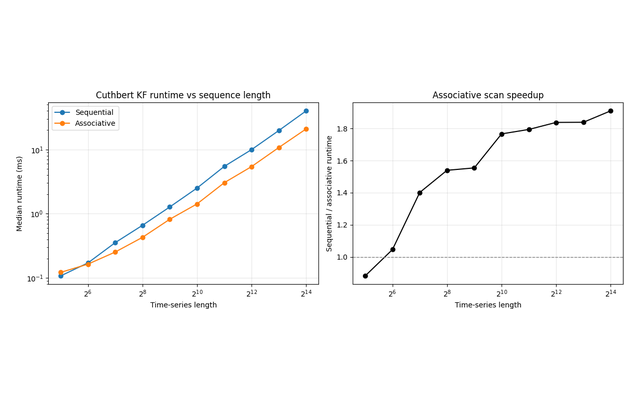

    **[Scaling the associative Cuthbert Kalman filter](deep_dives/discrete_time_kf_associative_scaling.ipynb)**

    <!-- Thumbnail source: cell plot-results, output 0. Trimmed and padded. -->

-   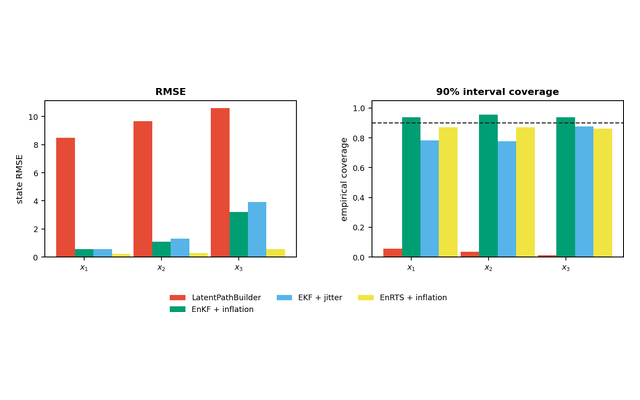

    **[Filtering deterministic processes](deep_dives/filtering_deterministic_processes.ipynb)**

    <!-- Thumbnail source: cell summarize-state-recovery, output 1. Trimmed and padded. -->

-   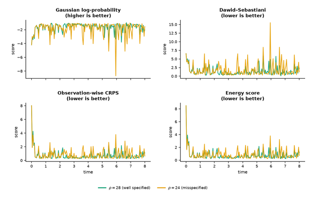

    **[Observation scoring with a Cuthbert EnKF](deep_dives/observation_scoring_with_cuthbert_enkf.ipynb)**

    <!-- Thumbnail source: cell 3aeb0829, output 1. Trimmed and padded. -->

-   

    **[Tuning EnKF covariance inflation with scoring rules](deep_dives/l63_covariance_inflation_scoring.ipynb)**

-   

    **[Learning EnKF localization with scoring rules](deep_dives/l96_localization_hyperparameter_scoring.ipynb)**

#### Parameter inference and identifiability

-   

    **[Faster Lorenz–63 inference with full-state observations](deep_dives/l63_speedup_dirac_vs_enkf.ipynb)**

-   

    **[Comparing MCMC algorithms](deep_dives/mcmc_inference_algorithm_comparison.ipynb)**

-   

    **[Comparing SDE discretizations on Lorenz–63](deep_dives/sde_discretization_comparison.ipynb)**

-   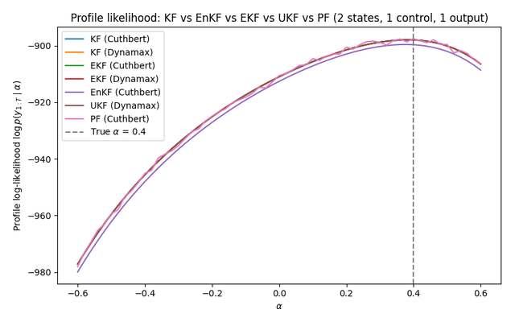

    **[Discrete-time LTI profile likelihood](deep_dives/discrete_time_lti_profile_likelihood.ipynb)**

    <!-- Thumbnail source: notebook cell 15 (zero-based), output 0. Trimmed and padded. -->

-   

    **[Continuous-time LTI profile likelihood](deep_dives/continuous_time_lti_profile_likelihood.ipynb)**

-   

    **[LTI identifiability and canonical parameterization](deep_dives/lti_identifiability_canonicalization.ipynb)**

#### Learning dynamics

-   

    **[Sparse identification of FitzHugh–Nagumo dynamics](deep_dives/fhn_sparse_id.ipynb)**

-   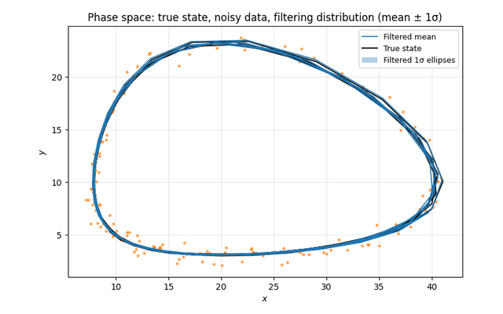

    **[Learning Lotka–Volterra dynamics with a universal ODE](deep_dives/lv_uode.ipynb)**

    <!-- Thumbnail source: cell d5fa65a1, output 1. Trimmed and padded. -->

-   

    **[Learning FitzHugh–Nagumo drift with a Gaussian process](deep_dives/gp_drift.ipynb)**

#### Partial differential equations

-   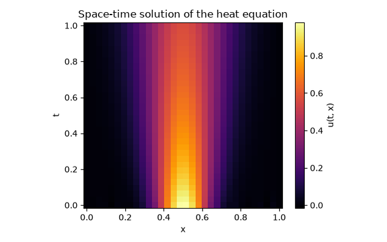

    **[Heat equation: Inferring an initial condition](deep_dives/pde/heat_equation_inference.ipynb)**

    <!-- Thumbnail source: cell a44a243e, output 0. Trimmed and padded. -->

-   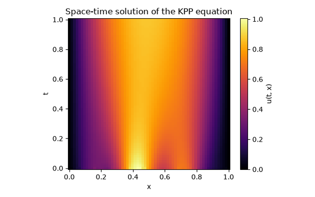

    **[Reaction–diffusion equation: Inferring a reaction rate](deep_dives/pde/reaction_diffusion_inference.ipynb)**

    <!-- Thumbnail source: cell ffca77e2, output 0. Trimmed and padded. -->

